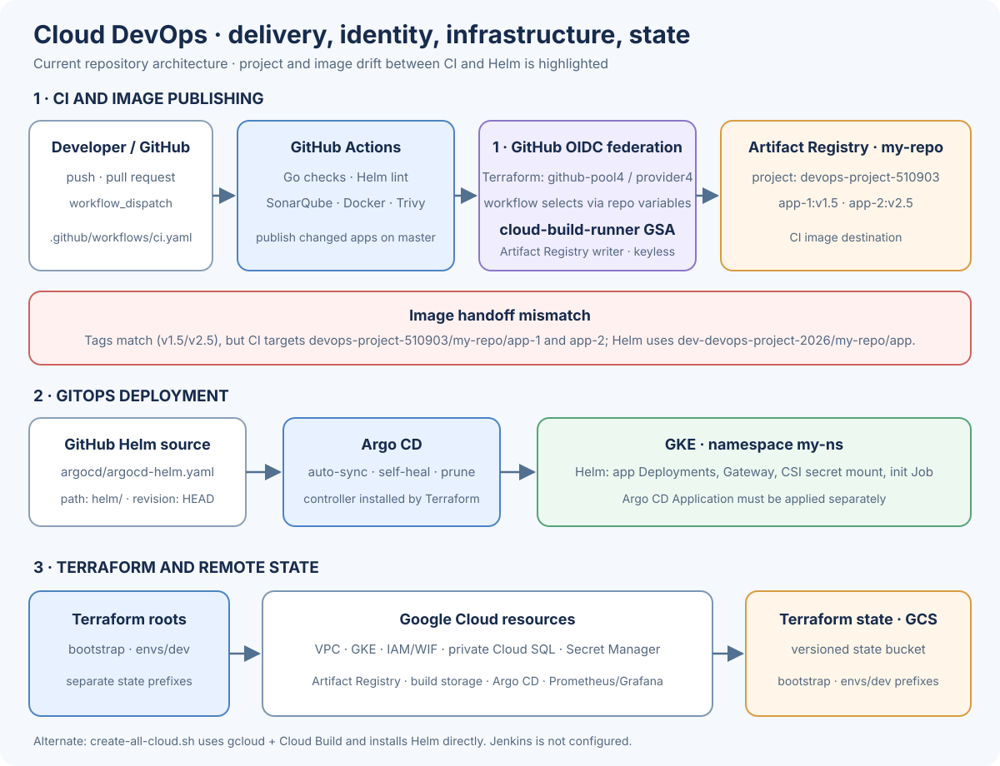
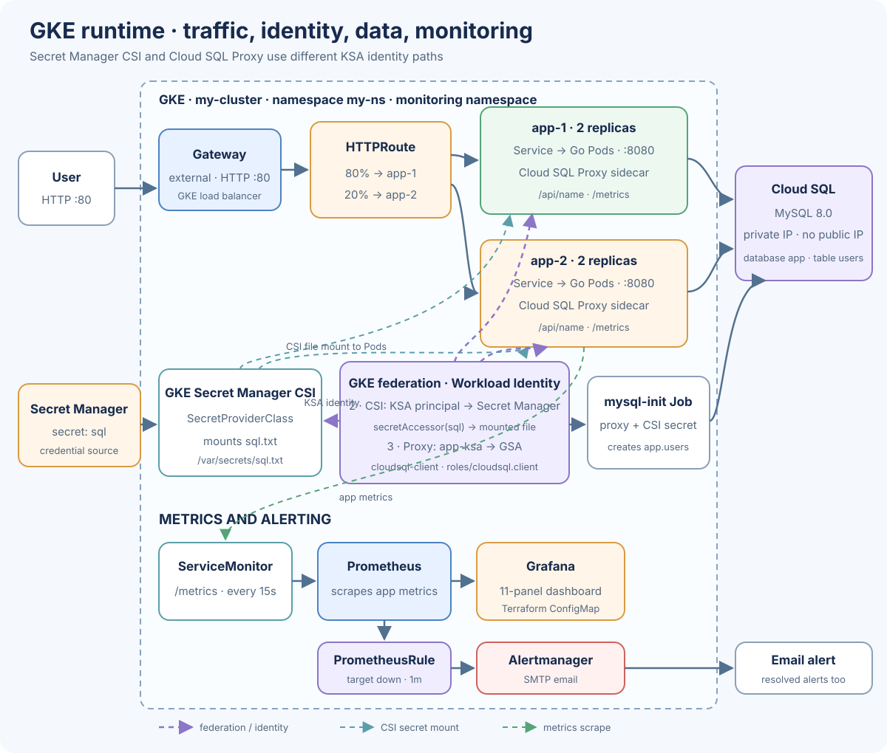

# Cloud DevOps Project

Two Go app variants run on GKE, share a private MySQL Cloud SQL instance, and receive HTTP traffic through an 80/20 Gateway API route. Terraform provisions Google Cloud; GitHub Actions builds and scans images; Argo CD syncs the Helm chart.

## Architecture

### Delivery and infrastructure

### Request path, identities, data, and monitoring

### The three federation paths

| Use | Identity flow | Permission / purpose |
| --- | --- | --- |
| CI publishing | GitHub OIDC → WIF provider → `cloud-build-runner` GSA | Terraform creates repository-restricted `github-pool4` / `github-provider4`; Artifact Registry writer. No service-account JSON key. |
| Secret file mount | GKE Pod KSA principal (`my-ns/app-ksa`) → Secret Manager | `roles/secretmanager.secretAccessor` on `sql`; GKE CSI mounts `/var/secrets/sql.txt`. |
| Cloud SQL Proxy | KSA `app-ksa` → impersonated GSA `cloudsql-client` | `roles/cloudsql.client` on the SQL instance; proxy connects over private IP. |

The Secret Manager CSI add-on uses the Pod's KSA principal directly. The separate KSA-to-GSA binding is for the Cloud SQL Proxy. [Google's GKE Secret Manager guide](https://docs.cloud.google.com/secret-manager/docs/secret-manager-managed-csi-component) documents this KSA principal flow.

Argo CD's source is a GitHub HTTPS URL; the checked-in manifest has no federation setup. If the repository is private, Argo CD needs separate Git credentials.
The optional `create-all-cloud.sh` path defines `github-pool2` / `github-provider2` for the same GitHub-to-GCP use; it is separate from Terraform's pool/provider, not another workload identity flow.

## Repository map

| Path | Purpose |
| --- | --- |
| `.github/` | GitHub Actions CI and image publishing |
| `app/` | Two Go web app versions and their Dockerfiles |
| `terraform/` | Infrastructure as code: project bootstrap, dev environment, and reusable modules |
| `helm/` | Kubernetes application chart and monitoring configuration |
| `argocd/` | Argo CD Application manifest for GitOps deployment |
| `k8s/` | Alternative raw Kubernetes manifests |
| `docs/assets/` | Architecture diagrams embedded in this README |
| `create-all-cloud.sh`, `cleanup-all-cloud.sh` | Separate manual cloud setup and teardown scripts |
